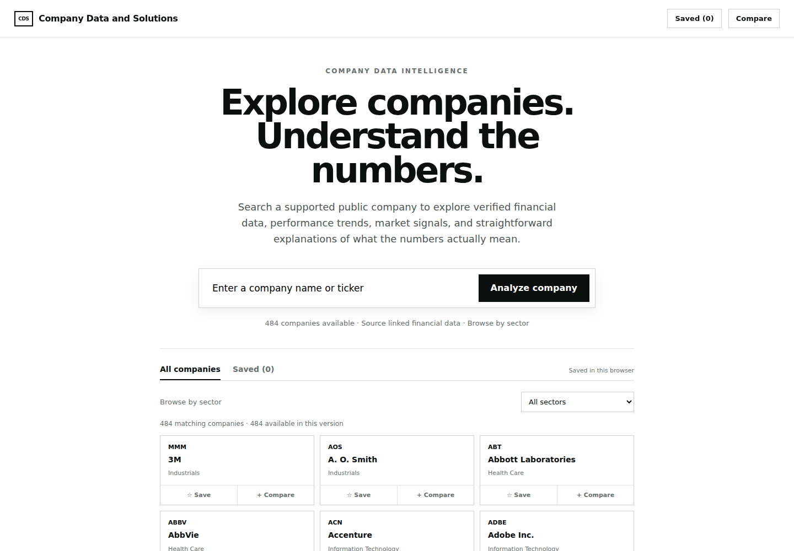
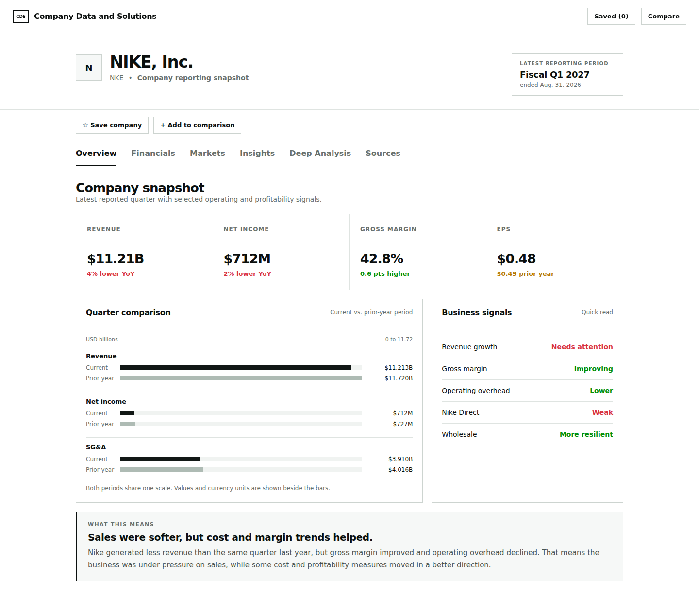
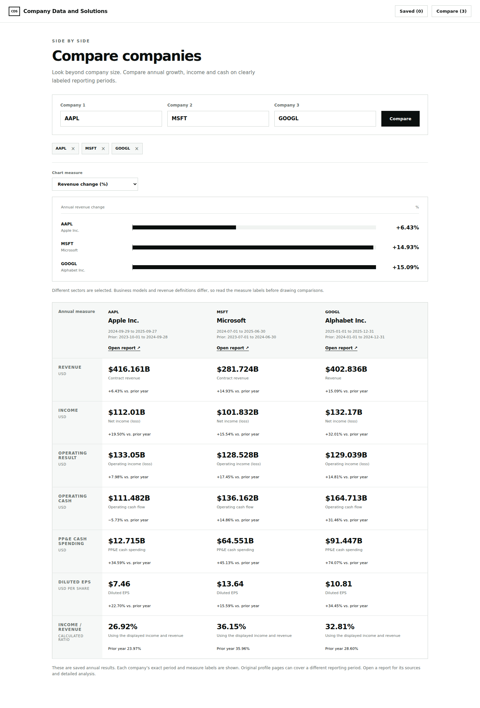
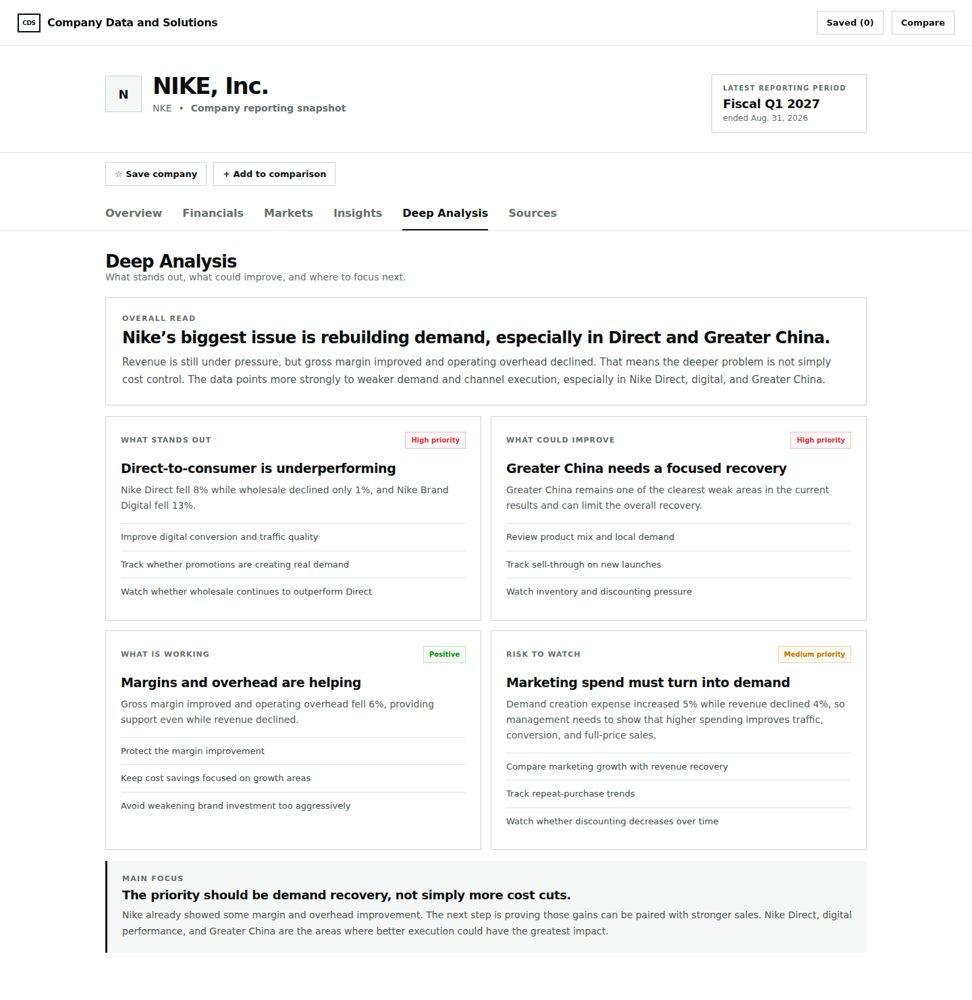

# Company Data and Solutions

Search company financial data, compare performance, and explore business insights.

**[Open the live website](https://yewnatam.github.io/Company-Data-and-Solutions/)**



## About the project

Company Data and Solutions (CDS) is a company analytics project built with Python, SQL, and JavaScript. It brings published financial results into one searchable website with charts, company comparisons, and plain English explanations.

## Search and browse

1. Enter a company name or ticker, such as Apple or AAPL, and select **Analyze company**.
2. Browse 484 supported company profiles or filter the directory by sector.
3. Explore **Overview**, **Financials**, **Markets**, **Insights**, **Deep Analysis**, and **Sources**.
4. Save companies in your browser or compare annual results for up to three companies.

Search looks through the project's saved company data. The **Sources** tab links to the original publications so visitors can look up where the numbers and observations came from. Saved companies stay in the browser used to save them.

## Data and research

Web search and browser research were used to locate company earnings releases, investor relations reports, and SEC filings. Saved source records include publication links, reporting periods, and whether each publication was opened or available only as a search excerpt. Python checks the saved inputs and matches company identities, dates, and units before loading them into SQLite.

SQL calculates changes in revenue and earnings, financial comparisons, and income as a share of revenue. JavaScript displays the results as charts, tables, and company reports. The [Costco analysis walkthrough](docs/analysis_walkthrough.md) shows a reproducible example using the [SQL queries](sql/portfolio_queries.sql).

The website uses a saved reporting snapshot. It does not search the web or automatically update when new reports are released. Reporting periods differ across profiles, and missing values remain separate from zero. SpaceX is included as a separate private company profile and is not available for annual comparisons.

## Documentation

* [Data sources and limitations](docs/data.md)
* [Company publication methods](docs/company_reports.md)
* [Source publication index](docs/company_sources.csv)
* [Python and SQL architecture](docs/architecture.md)
* [Project file guide](docs/files.md)
* [Deployment guide](docs/deployment.md)

## Requirements

### Software

1. Python 3.11 or later to build the website and process the data.
2. A web browser to use the website.
3. Node.js 22 or later to run the JavaScript checks.

The Python build uses the standard library. No API key, paid database, or Python package installation is required.

### Local setup

1. Download and extract the source, then open a terminal in the project folder containing `README.md`.

2. Build the website:

   ```bash
   python3 -m cds build
   ```

3. Start the local website:

   ```bash
   python3 -m http.server 8000 --directory dist
   ```

4. Open **http://localhost:8000** in your browser. Press **Ctrl+C** in the terminal to stop the server.

On Windows, use `python` instead of `python3` if needed. You can also open `dist/index.html` directly. The generated page includes its data, styles, and scripts; opening source publication links requires internet access.

### Website deployment

The included GitHub Pages workflow tests the project, builds the website, and publishes `dist/`.

1. Upload the extracted source files to the `Company-Data-and-Solutions` repository, with `README.md` at the root.
2. Open **Settings → Pages** and select **GitHub Actions** as the source.
3. Open **Actions → Publish website → Run workflow** and select `main`.
4. After deployment succeeds, open the website link shown by GitHub. Add that confirmed link to the repository's **About → Website** field and this README.

Later pushes to `main` run the checks and publish the updated website. See the [deployment guide](docs/deployment.md) for updates, rollback, and the optional Vercel configuration.

## Development

### Tools

| Tool | Use in CDS |
| --- | --- |
| Python | Validate source files, match company data, load SQLite, and build the website |
| SQL and SQLite | Store related records and calculate financial comparisons |
| JavaScript | Company search, sector browsing, Saved, Compare, and charts |
| HTML and CSS | Website structure and layout |
| GitHub Actions | Run checks and publish the website |

### Checks

```bash
python3 -m unittest discover -s tests -v
node --test tests/web.test.cjs
```

The 29 Python checks and 34 JavaScript checks cover source integrity, company matching, reporting periods, SQL calculations, search, navigation, Saved, and Compare. These checks do not independently audit every source publication.

### Export data

```bash
python3 -m cds report --company AAPL
python3 -m cds report > comparisons.csv
```

The CSV exports saved SEC comparisons. Website reports can use company published financial pairs, so their displayed figures and periods can differ from the CSV.

## Website preview

### Company overview

Reporting periods, financial charts, and business signals in one view.



### Company comparison

Compare annual measures for up to three companies, with fiscal dates and measure definitions shown alongside the figures.



### Deep Analysis

Company observations, supporting evidence, and suggested business actions.



## Author and source availability

Created by **Yewnata Mekonen**. Source is available for project review with all rights reserved. See [LICENSE](LICENSE). Company publications, financial facts, names, and trademarks retain their own rights and terms.
